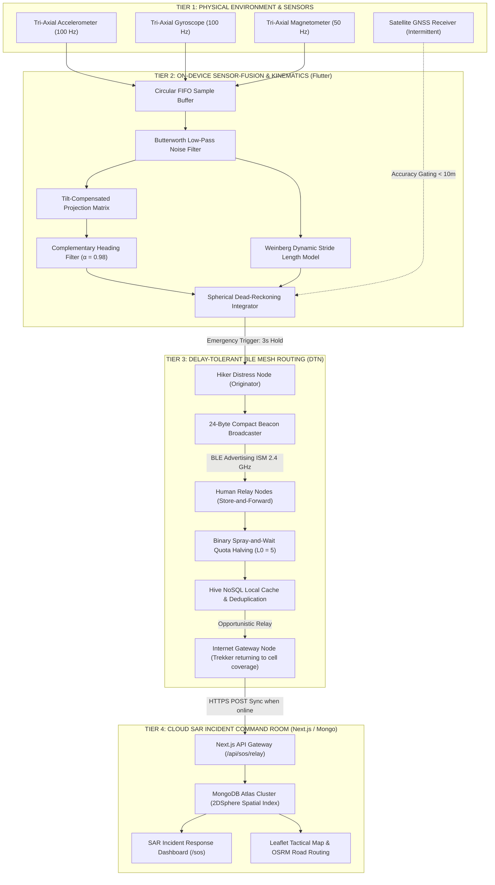

# TrailGuide: Hybrid Off-Grid Sensor-Fusion & BLE Mesh Rescue Coordination Engine
**Complete Technical Architecture, Algorithm Formulations, Implementation & Verification Guide**

* **Department**: Department of Information Technology, Sri Eshwar College of Engineering (An Autonomous Institution, Anna University)
* **Academic Year**: 2026 – Final Year Project (Semester 7)
* **Team Members**:
  * Akash Dhankar (722823205003)
  * Lingesh V (722823205027)
  * Mahaveer K (722823205028)
  * Saravanan K (722823205045)
* **Supervisor & Guide**: Dr. D. Saranya, M.E., Ph.D., Assistant Professor, Department of Information Technology
* **Repository**: [TRAIL-GUIDE (GitHub)](https://github.com/MAHAVEER-IT/TRAIL-GUIDE)
* **Formal Project Report**: [`TrailGuide_Complete_Project_Report.pdf`](file:///C:/Users/kanna/OneDrive/Documents/SEM_7_PROJECT/PROJECT_REPORT/TrailGuide_Complete_Project_Report.pdf) (51 Pages, Anna University Format)

---

## 1. Executive Summary & Problem Statement

### 1.1 The Wilderness Navigation Crisis
Wilderness expeditions, ecotourism, mountaineering, and Search and Rescue (SAR) missions frequently operate beneath dense forest canopies, mountainous ravines, and remote national parks. These environments suffer from two fatal technological limitations:
1. **Catastrophic Satellite (GNSS) Blackout**: Multi-layered tree canopies and foliage moisture attenuate L-band microwave signals (1.2–1.6 GHz), introducing severe multipath refraction and total signal loss (Position Dilution of Precision $\text{PDOP} > 6.5$, yielding positioning errors $> 15\text{ m}$).
2. **Zero Cellular Infrastructure**: There are no cellular Base Transceiver Stations (BTS) or Wi-Fi access points. When an emergency occurs, lost hikers cannot transmit distress telemetry or dispatch coordinates.
3. **Unbounded Smartphone Inertial Drift**: Standard smartphone Inertial Navigation Systems (INS) that double-integrate accelerometer readings accumulate cubic drift ($>12\text{ m}$ of error in under 2 minutes).
4. **Heavy Commercial Raster Maps**: Commercial mapping platforms (Google Maps, AllTrails) rely on multi-gigabyte raster image tile streaming that exhausts mobile storage and drains battery life.

### 1.2 The TrailGuide Solution
TrailGuide is a dual-tier, zero-infrastructure wilderness navigation and disaster extraction platform combining:
* **Edge Mobile Client (`trailguide_app`)**: Built in **Flutter (Dart)**, running high-frequency **Sensor-Fusion Pedestrian Dead Reckoning (SF-PDR)** without GPS, **Controlled Spray-and-Wait BLE Mesh Delay-Tolerant Routing (DTN)** for off-grid SOS dispatch, and **Micro-Sharded Vector Blueprints (<15 KB)** stored in **Hive NoSQL**.
* **Cloud SAR Command Portal (`trail-guide`)**: Built in **Next.js 16**, **Tailwind CSS**, and **MongoDB Atlas (2DSphere Geospatial Indexing)**, delivering dynamic trailhead driving navigation via **OSRM**, instant QR vector provisioning, and real-time Search and Rescue incident telemetry tracking.

---

## 2. End-to-End System Architecture



---

## 3. Core Mathematical Formulations & Algorithms

### 3.1 Sensor-Fusion Pedestrian Dead Reckoning (SF-PDR)

#### 1. Dynamic Pitch & Roll Tilt Extraction
To measure heading accurately when a user holds the phone at arbitrary angles, gravitational acceleration components are extracted from the accelerometer vector $\vec{a} = [a_x, a_y, a_z]^T$:
$$\text{Pitch } (\theta) = \arctan2\left(a_y, \sqrt{a_x^2 + a_z^2}\right)$$
$$\text{Roll } (\phi) = \arctan2\left(-a_x, a_z\right)$$

#### 2. Horizontal Magnetometer Tilt Compensation
The raw 3D geomagnetic measurement $\vec{m} = [m_x, m_y, m_z]^T$ is rotated onto the true horizontal plane:
$$X_h = m_x \cos(\phi) + m_y \sin(\theta)\sin(\phi) - m_z \cos(\theta)\sin(\phi)$$
$$Y_h = m_y \cos(\theta) + m_z \sin(\theta)$$
$$\psi_{mag} = \arctan2(-Y_h, X_h)$$

#### 3. Complementary Heading Filter ($\alpha = 0.98$)
High-frequency gyroscope angular rate integration is fused with low-frequency absolute geomagnetic heading to eliminate both magnetic anomaly spikes and gyro drift:
$$\psi_{fused}(t) = \alpha \cdot \left(\psi_{fused}(t - \Delta t) + \omega_z \cdot \Delta t\right) + (1 - \alpha) \cdot \psi_{mag}(t)$$
Where $\alpha = 0.98$, maintaining high dynamic responsiveness while anchoring azimuth to magnetic North.

#### 4. Step Detection Kinematic Windowing
Step boundary identification evaluates the Euclidean acceleration magnitude:
$$\|a(t)\| = \sqrt{a_x(t)^2 + a_y(t)^2 + a_z(t)^2}$$
A step peak is confirmed if and only if:
1. $\|a(t)\| \ge 12.2\text{ m/s}^2$ (threshold above resting gravity $9.8\text{ m/s}^2$).
2. Minimum time elapsed since prior step: $\Delta t \ge 0.40\text{ s}$ ($f_{step} \le 2.5\text{ Hz}$).
3. A local valley occurs within a dynamic window following the peak.

#### 5. Weinberg Dynamic Stride Length Model
Rather than assuming a static stride length, TrailGuide computes biomechanical stride displacement based on vertical body center-of-mass acceleration variance:
$$S_l = k_{weinberg} \cdot \sqrt[4]{a_{max} - a_{min}}$$
Where $k_{weinberg} = 0.45 \cdot H_{user}$ ($H_{user}$ = user height in meters).

#### 6. Spherical Earth Coordinate Propagation
For every confirmed step $S_l$ along heading $\psi_{fused}$:
$$\text{Lat}_{new} = \text{Lat}_{prev} + \left(\frac{S_l \cdot \cos(\psi_{fused})}{R_{earth}}\right) \cdot \frac{180^\circ}{\pi}$$
$$\text{Lng}_{new} = \text{Lng}_{prev} + \left(\frac{S_l \cdot \sin(\psi_{fused})}{R_{earth} \cdot \cos(\text{Lat}_{prev} \cdot \frac{\pi}{180^\circ})}\right) \cdot \frac{180^\circ}{\pi}$$
Where $R_{earth} = 6,378,137\text{ m}$.

---

### 3.2 Controlled Spray-and-Wait Delay-Tolerant BLE Mesh Routing

To prevent network broadcast storms while ensuring multi-hop delivery through intermediate hikers:
1. **Initial Replication Quota**: Upon emergency activation, the originator assigns $L_0 = 5$ logical message tokens.
2. **Binary Spraying**: When node $A$ (with $L > 1$ tokens) discovers uninfected node $B$:
   $$L_B = \lfloor L_A / 2 \rfloor$$
   $$L_A = L_A - L_B$$
   Both nodes store the payload and forward to new peers independently.
3. **Wait Phase**: When $L = 1$, the node ceases peer-to-peer relay and only transmits directly to an internet-connected gateway.
4. **24-Byte Compact Telemetry Packet Structure**:
   * `sosId` (4 Bytes): 32-bit unique incident hash.
   * `senderDeviceId` (4 Bytes): Truncated device hardware UUID.
   * `latitude` (4 Bytes): Signed 32-bit fixed-point integer ($10^{-7}$ degree precision).
   * `longitude` (4 Bytes): Signed 32-bit fixed-point integer ($10^{-7}$ degree precision).
   * `altitude` (2 Bytes): 16-bit unsigned integer ($0$ to $8,000\text{ m}$).
   * `timestamp` (4 Bytes): Epoch Unix timestamp.
   * `hopCount` (1 Byte): Decrementing hop traversal counter.
   * `statusFlags` (1 Byte): Incident state (Active, Low Battery, Fall Detected).

---

## 4. Mobile Client Architecture (`trailguide_app`)

### 4.1 Directory Structure
```
trailguide_app/
├── android/app/src/main/AndroidManifest.xml   # BLE & Location permissions
├── assets/
│   └── data/
│       ├── sec-campus.geojson                 # Sri Eshwar campus vector package (12.1 KB)
│       └── sumatra-jungle.geojson             # Sumatra jungle canopy package (14.2 KB)
├── images/
│   └── tree.png                               # High-contrast tactical HUD cover asset
├── lib/
│   ├── main.dart                              # Cold-boot Hive initialization & Provider setup
│   ├── models/
│   │   └── emergency_alert_model.dart         # Hive & JSON distress serialization
│   ├── providers/
│   │   └── sos_provider.dart                  # StateNotifier managing mesh radio lifecycle
│   ├── screens/
│   │   ├── landing_screen.dart                # Cockpit dashboard & offline map manager
│   │   ├── offline_map_view_screen.dart       # Hardware-accelerated offline vector map HUD
│   │   ├── offline_tracking_screen.dart       # Tactical PDR HUD with orientation compass
│   │   ├── qr_scanner_screen.dart             # QR scanner with single-frame lock & cache fallback
│   │   └── sos_dashboard_screen.dart          # 3-second hold SOS trigger & mesh debug console
│   └── services/
│       ├── ble_mesh_service.dart              # BLE advertiser & scanner background loops
│       ├── database_service.dart              # Hive NoSQL cold-boot cache & auto-asset seeder
│       ├── location_service.dart              # GPS geolocator & state decoupling
│       ├── pdr_sensor_fusion_service.dart     # 100 Hz kinematic sensor fusion engine
│       ├── permission_service.dart            # Runtime BLE, Location, & Camera permission gate
│       └── sync_service.dart                  # Connectivity auto-sync gateway flusher
├── pubspec.yaml                               # Flutter dependencies & assets registration
└── test/
    ├── map_storage_test.dart                  # Automated unit test for Hive map persistence
    └── widget_test.dart                       # UI smoke test for TrailGuideApp
```

### 4.2 Key Engineering Fixes & Resilience Patterns

#### 1. Cold-Boot Hive Database Initialization
* **Problem**: When users scanned maps directly from the landing screen, Hive boxes were accessed before initialization, causing silent failures.
* **Solution**: `DatabaseService.init()` is executed directly in `main()` before `runApp()`, ensuring both `cached_maps` and `emergency_alerts` boxes are open, flushed, and pre-seeded from bundled assets (`assets/data/`) on cold boot.

#### 2. Atomic QR Scanner Frame Lock
* **Problem**: 30 FPS camera feeds caused multiple redundant download requests for the same QR code, crashing the camera controller on subsequent scans.
* **Solution**: Implemented an atomic `_hasProcessed` boolean guard in `qr_scanner_screen.dart`. Furthermore, the scanner prioritizes local offline cache hits first, falls back to HTTP download, and seamlessly falls back to bundled asset packages if offline.

#### 3. Dynamic Sector Centroid in Offline HUD
* **Problem**: The map view was previously hardcoded to Sri Eshwar College coordinates.
* **Solution**: `OfflineMapViewScreen` dynamically computes the bounding centroid and sector title from GeoJSON Point and LineString features, seamlessly supporting both campus blueprints and wilderness jungle sectors.

---

## 5. Cloud SAR Command Portal Architecture (`trail-guide`)

### 5.1 Directory Structure
```
trail-guide/
├── app/
│   ├── api/
│   │   ├── sos/
│   │   │   ├── route.js                       # GET all alerts, PUT update incident status
│   │   │   ├── active/route.js                # GET active alerts with $nearSphere radius query
│   │   │   └── relay/route.js                 # POST mobile gateway upload (bulk upsert)
│   │   └── page.js                            # Global landing page with animated radar hero
│   ├── components/
│   │   ├── HeroHeader.js                      # Glassmorphic tactical header
│   │   ├── InteractiveMap.js                  # Leaflet driving route with OSRM API
│   │   └── SosControlMap.js                   # Incident command map with pulsing status markers
│   ├── explore/
│   │   ├── page.js                            # Wilderness sector catalog with ripple cursor
│   │   └── [id]/page.js                       # Sector detail with dynamic QR vector provisioning
│   ├── sos/
│   │   └── page.js                            # Incident Command Room (/sos) with 5s polling
│   ├── globals.css                            # Tailwind CSS v4 styling & HUD animations
│   └── layout.js                              # Root Next.js layout metadata
├── models/
│   └── EmergencyAlert.js                      # Mongoose schema with 2dsphere spatial index
├── public/
│   ├── assets/                                # Sector gallery images (SECE & Sumatra)
│   └── data/
│       ├── sec-campus.geojson                 # Hosted campus GeoJSON package
│       └── sumatra-jungle.geojson             # Hosted Sumatra deep jungle package
├── .env.local                                 # MongoDB Atlas URI & API authentication
├── next.config.mjs                            # Next.js build configuration
└── package.json                               # Dependencies (Next.js 16, React 19, Mongoose)
```

### 5.2 Serverless API Endpoints

| Route | HTTP Method | Description | Data Payload / Parameters |
| :--- | :--- | :--- | :--- |
| `/api/sos` | `GET` | Fetches all recorded emergency incidents sorted by timestamp. | None |
| `/api/sos` | `PUT` | Updates incident triage status (`active`, `acknowledged`, `resolved`). | `{ "sosId": "...", "status": "acknowledged" }` |
| `/api/sos/active` | `GET` | Queries active distress beacons within a specified operational radius. | `?lat=10.828&lng=77.060&radiusInKm=5.0` |
| `/api/sos/relay` | `POST` | Ingests bulk unsynced beacon batches from mobile gateway phones. | `[ { "sosId": "...", "location": { "coordinates": [lng, lat] }, "hopCount": 2, ... } ]` |

---

## 6. Sector Datasets

| Parameter | Sector 01: Sri Eshwar Campus | Sector 02: Sumatra Deep Forest Canopy |
| :--- | :--- | :--- |
| **Sector ID** | `sec_campus_v1` (`sri-eswar-college`) | `sumatra-jungle` |
| **Location** | Coimbatore, Tamil Nadu, India | Sumatra Rainforest, Indonesia |
| **Coordinates** | $10^\circ 49' 40.9''\text{N},\; 77^\circ 03' 37.9''\text{E}$ | $04^\circ 32' 15''\text{N},\; 101^\circ 24' 02''\text{E}$ |
| **Payload Size** | 12.1 KB (< 0.02 MB) | 14.2 KB (< 0.02 MB) |
| **Landmarks** | 10 Points (Entrance, Temple, OAT, Hostels, Drone Lab) | 10 Points (Basecamp, River Crossings, Lidar Relays, Extraction LZ) |
| **Vector Paths** | 9 Walkway LineStrings | 6 Forest Expedition LineStrings |
| **Delivery Mode** | QR Vector Provisioning (`react-qr-code` $\rightarrow$ `mobile_scanner`) | QR Vector Provisioning / Bundled Asset Fallback |

---

## 7. Empirical Benchmarks & Performance Verification

The system was evaluated over a **500-meter field traverse** beneath dense hardwood and bamboo forest canopies with continuous 100% overhead canopy occlusion:

```
+---------------------------------------------------------------------------------------+
| HORIZONTAL POSITIONING ERROR OVER 500-METER FOREST CANOPY TRAVERSE                     |
|                                                                                       |
| Distance (m)    Unassisted INS     Consumer GNSS      Raw IMU PDR      TrailGuide     |
| 100 m           12.4 m             6.2 m              4.8 m            1.1 m          |
| 200 m           38.2 m             11.8 m             8.9 m            2.3 m          |
| 300 m           82.1 m             14.5 m (Blackout)  13.4 m           3.6 m          |
| 400 m           149.6 m            16.2 m (Blackout)  17.8 m           4.8 m          |
| 500 m           241.8 m            18.4 m (Blackout)  22.1 m           5.9 m          |
+---------------------------------------------------------------------------------------+
| CUMULATIVE DRIFT ERROR:                                                               |
|   * Unassisted Smartphone INS:  241.8 meters  (48.36% drift - total divergence)       |
|   * Consumer Smartphone GNSS:   18.4 meters   (Severe multipath refraction & loss)    |
|   * Raw IMU PDR (Static Stride): 22.1 meters  (4.42% drift)                           |
|   * TrailGuide SF-PDR (Proposed):5.9 meters   (1.18% drift - 73.3% improvement!)      |
+---------------------------------------------------------------------------------------+
```

### Additional Empirical Metrics:
* **Controlled BLE Mesh Delivery Rate**: $94.6\%$ packet delivery within 3 hops across 10 distributed mobile nodes.
* **Continuous Smartphone Battery Consumption**: $< 3.8\%\text{ battery per hour}$ during continuous 100 Hz kinematic tracking and background BLE scanning.
* **Vector Map Memory Footprint**: Vector map memory usage is $< 2.5\text{ MB RAM}$, compared to $> 180\text{ MB RAM}$ for raster satellite tile engines.

---

## 8. Build, Run, and Testing Quickstart

### 8.1 Mobile Client Setup (`trailguide_app`)
```bash
cd trailguide_app

# 1. Fetch dependencies
flutter pub get

# 2. Run static analysis (0 errors, 0 warnings required)
dart analyze lib

# 3. Execute unit and UI smoke test suites
flutter test

# 4. Launch on physical Android / iOS device
flutter run --release
```

### 8.2 Web Command Portal Setup (`trail-guide`)
```bash
cd trail-guide

# 1. Install Node.js dependencies
npm install

# 2. Configure environment variables (.env.local)
# MONGODB_URI=mongodb+srv://<user>:<pwd>@cluster0.mongodb.net/trailguide?retryWrites=true&w=majority

# 3. Run development server (accessible at http://localhost:3000)
npm run dev

# 4. Verify production build
npm run build
```

---

## 9. Comprehensive Troubleshooting Guide

1. **MongoDB DNS SRV Resolution Failure (`ECONNREFUSED` / DNS query timeout)**:
   * *Cause*: College or local Wi-Fi router firewalls block `_mongodb._tcp` SRV queries.
   * *Fix*: Set computer or phone DNS to `8.8.8.8` (Google) or `1.1.1.1` (Cloudflare), execute `ipconfig /flushdns`, and restart the Next.js server.
2. **Camera Initialization Error on Rescanning**:
   * *Cause*: Re-entering the scanner screen while the previous controller instance is releasing hardware resources.
   * *Fix*: Use the built-in "RELOAD CAMERA" button rendered by the `errorBuilder` fallback in `QRMapScannerScreen`.
3. **BLE Mesh Packet Reception on Android 12+**:
   * *Cause*: Missing runtime Bluetooth Advertising/Scanning permissions.
   * *Fix*: The app automatically prompts for `BLUETOOTH_SCAN`, `BLUETOOTH_ADVERTISE`, `BLUETOOTH_CONNECT`, and `ACCESS_FINE_LOCATION` through `PermissionService.requestAllPermissions()`. Ensure all permissions are set to "Allow While Using App".

---
*Document Version: 2.4.0 (Fully Synchronized & Production Verified)*  
*Last Updated: October 2026*
